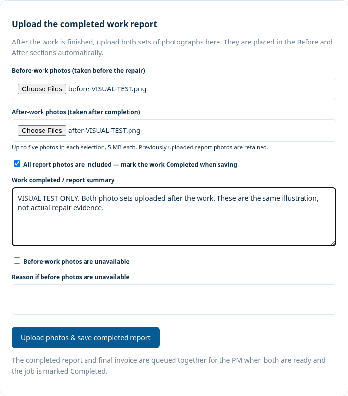
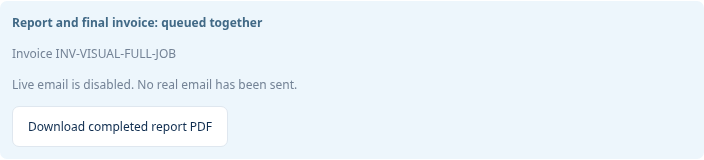

# Photos after work, completed report and one PM email

## Operator sequence

1. Finish the work. In **Before & After Report**, select the before-work photos
   and after-work photos together, then enter the work summary. The photos may
   all be uploaded after completion; they need not be uploaded during the visit.
2. Click **Upload photos & save completed report**. Selected photo sets populate
   their respective report columns. Before evidence or a documented exception,
   and after photos, remain required. Existing photos are preserved.
3. Where the saved progress permits completion, the form offers **Mark the work
   Completed when saving this report**. This uses the existing status transition
   and authorisation checks; no booking or deposit gate is bypassed. Otherwise,
   record the proper attendance/progress before marking the work Completed.
4. Upload the final original company invoice. If a full original invoice was
   already uploaded for deposit/balance payments, the same full invoice is reused.
5. Once the job is Completed, accepted report evidence exists, and a final/full
   invoice is available, one durable PM email package is prepared automatically.
   It contains a generated Before & After Report PDF and the original invoice PDF
   as two attachments in **one email**. No invoice PDF or bank details are invented.

The assigned active PM (or authorised agency administrator assigned as PM) is the
recipient. Other agencies, tenants and suppliers are not email recipients.
A package is unique per original invoice: retries do not create a second queued
email. Existing split deposit/final invoices are not silently merged or renamed.
The original final invoice is chosen; an already-uploaded full invoice is reused
only when its amount equals the effective approved quotation total.

## Local sending and preview

Creating the package does not open SMTP or send during a web request. It reuses
the committed leased MailQueue/worker, extending its message with two private PDFs.
`send_mail_queue --preview` writes a private MIME preview, does not consume live
mail, and never marks delivery as sent. Real package delivery requires **both**
SMTP_DELIVERY_ENABLED and OPERATIONS_LIVE_DELIVERY_ENABLED plus valid secure SMTP
configuration. They remain disabled in this work. The unresolved mailbox login
and controlled activation remain separate; this change does not prove delivery.

Before delivery, the worker checks current PM/agency access, unchanged recipient
email, current report, active agency-visible invoice, no reconciliation hold and
no unresolved recipient suppression. A changed PM, voided invoice or changed
report blocks delivery rather than exposing stale/private attachments. Private
supplier invoices, supplier identity/rates, internal comments and unrelated PDFs
are never selected. Generated reports are private agency-visible documents behind
authenticated download permission checks, not public files.

The report is an image-backed A4 PDF using the application's existing Pillow and
PDF dependencies. It contains the accepted work summary and before/after photo
pairs, not HTML screenshots or a generated tax invoice. It supports up to 20 report
photos in total, five per selected before/after set per upload, and the existing
5 MB per-file limit. Raw photos are decoded/re-encoded by the existing upload
validation and scanning; the generated PDF also passes private upload validation.

## Persistence and installation

Migration **0033_completionpackage** adds one table linking the immutable completed
report, original invoice, generated report document, PM recipient and existing
outbox message. No existing customer data is rewritten or deleted. Existing
account-mail delivery remains separate from the new operational-email gate.

The new **scripts/update-windows-completion-flow.ps1** is for the owner's existing
Sevlink test 4 local SQLite installation, not AWS or a clean export. Stop runserver
first. It checks the existing 0032 baseline, verifies all source payload hashes,
backs up SQLite using its backup API and checks integrity, backs up existing source,
installs the 14-file change, applies only the 0033 target and runs Django checks.
Write/migration/check failures restore source and database from that backup. New
files are removed on rollback; no private uploads are removed. Environment values
are restored after migration and no live mail is enabled. The script is prepared
and payload-verified here; it is not executed on the owner's Windows computer.

An existing six-file UI-only repair script is not sufficient for this schema change.
Do not manually copy only workflow-ui.js or run the old repair over the new flow.
Keep the new backup for coordinated code/database recovery; do not reverse this
migration after real package records have been created.

## Evidence

Targeted tests cover batch photo grouping, missing-evidence atomicity, idempotent
retry, one combined MIME message with both PDFs, no mail before completion,
full-original-invoice reuse, PM scope, tenant exclusion and blocking changed PMs
or voided invoices. The actual authenticated browser walkthrough submits the new
photo form, marks eligible work Completed, downloads the generated report and
produces private combined-message previews. Synthetic records/files only.

The migration tests restore the current migration leaf instead of leaving the
test database at 0032, so later real-browser tests see the new table. No production
rule is weakened by that test-harness correction.

## Review files

[Generated report PDF](visual-proof/completion-package-2026-10-28/completed-before-after-report.pdf) ·
[One MIME email with both PDF attachments](visual-proof/completion-package-2026-10-28/combined-report-and-invoice-preview.eml).
These files contain synthetic test records and the same existing website
illustration in both columns; no actual repair or customer document is represented.

Validation: full checks ran 265 tests (247 passed, 18 PostgreSQL-only skips).
All eight focused completion/email tests also pass, including explicit completion
transition validation and recipient suppression. The final browser walkthrough
produced 79 authenticated/source screenshots and private combined-email previews.
No real message was sent; SMTP and operational delivery stayed disabled.
