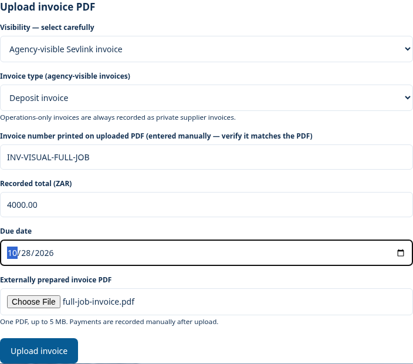
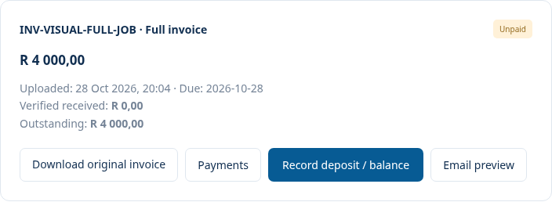
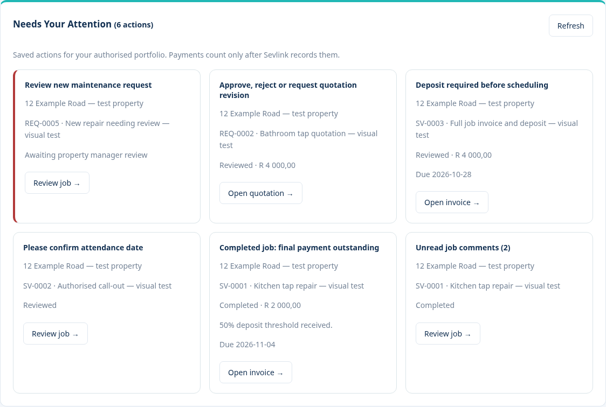
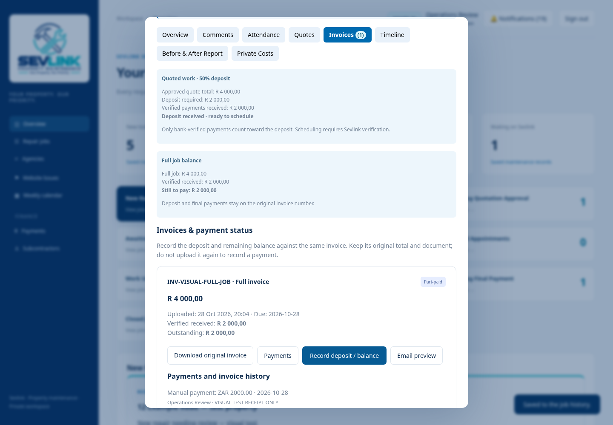
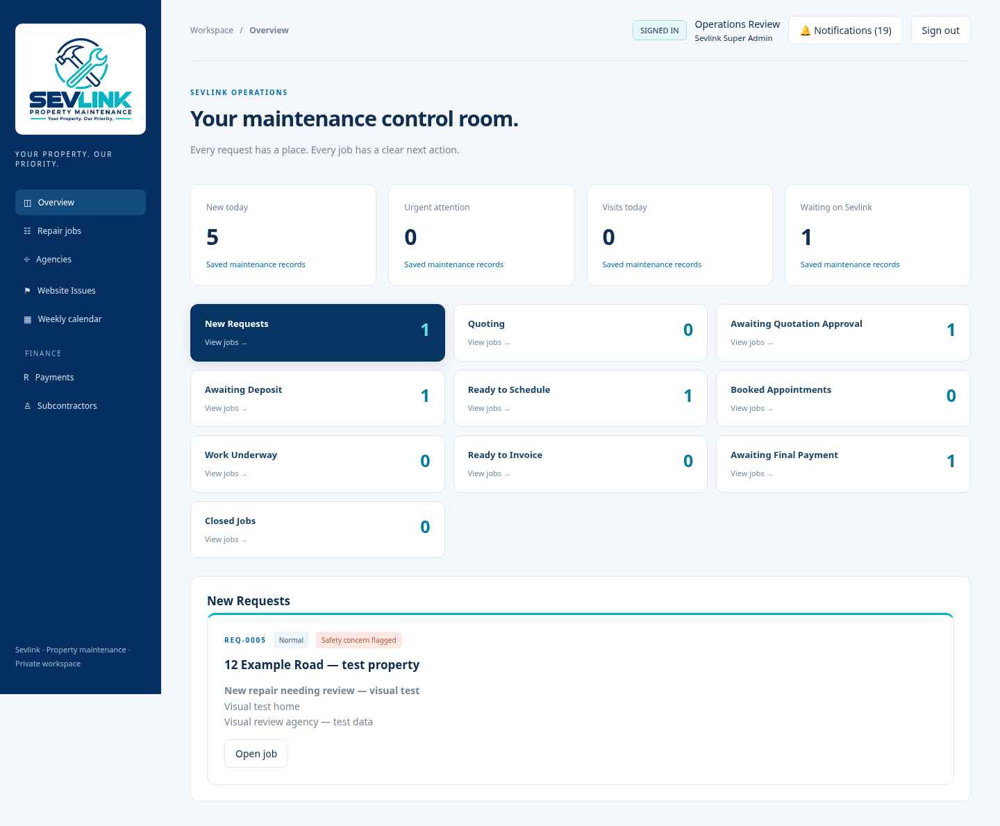
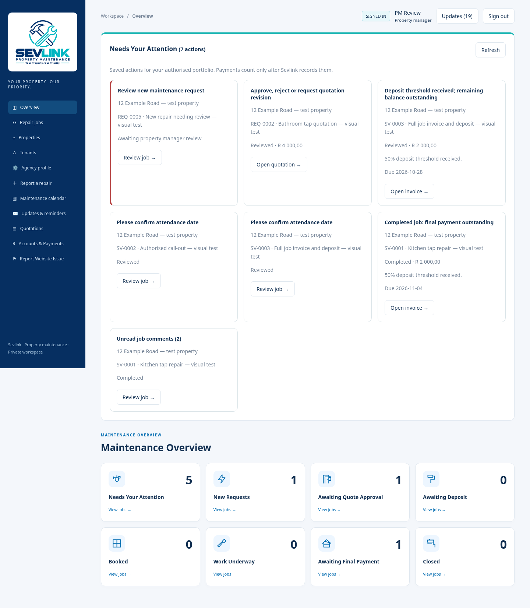
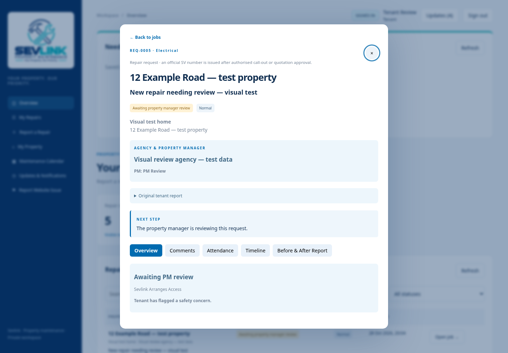
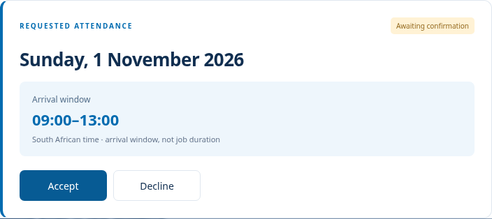

# Sevlink authenticated design review — 28 October 2026

The screenshots below are captured from the actual authenticated Django portal,
using saved records and PDFs in an isolated temporary SQLite database. They are
not UI mockups. People, jobs, documents and image evidence are explicitly synthetic.
The owner's existing Windows database and private files were not touched.

The original published demo's 30 served files match `portal/dist/` byte for byte.
See [source verification, component mapping and exact remaining differences](DEMO-SOURCE-DESIGN-COMPARISON.md)
and [the per-file hashes](DEMO-SOURCE-HASHES.json).

## Upload the PDF, then see the saved invoice

The next screenshot follows a successful POST of that PDF through the actual
Django invoice endpoint. It starts Unpaid; no received money is invented.

[Before this change: expanded invoice/payment/accounting forms](visual-proof/source-design-2026-10-28/before-operations-invoices.png).
The original-document download, payment ledger and staff-only adjustments remain.
They now open from the compact invoice card. The saved-value Email preview never
sends an email. The absent pending-POP upload workflow is explicitly documented,
not represented by a non-working button.

## Real attention and deposit verification

The browser walkthrough checks that eligibility is false after payment but before
verification, then true after the Super Admin verifies. The invoice keeps its
original number and full recorded total; remaining money is still outstanding.

## Super Admin, PM and agency dashboards

[Agency Admin dashboard](visual-proof/source-design-2026-10-28/admin-overview.png) ·
[Published source Operations dashboard](visual-proof/source-design-2026-10-28/source-operations-overview.png) ·
[Published source PM dashboard](visual-proof/source-design-2026-10-28/source-pm-overview.png).

The original stage/card styling is reused; the existing ten real Operations stages
and the previously approved eight PM cards are retained. Prototype stage changes
are not invented as database transitions.

## Existing REQ records and tenant privacy

[PM opening a saved REQ](visual-proof/source-design-2026-10-28/pm-existing-req.png) ·
[Super Admin opening the same request](visual-proof/source-design-2026-10-28/operations-existing-req.png).
Existing unapproved requests retain their REQ number; no official SV is invented.

## Six separate core job panels

| Panel | Actual authenticated screenshot |
| --- | --- |
| Comments | [Open screenshot](visual-proof/source-design-2026-10-28/operations-job-comments.png) |
| Attendance | [Open screenshot](visual-proof/source-design-2026-10-28/operations-job-attendance.png) |
| Quotes | [Open screenshot](visual-proof/source-design-2026-10-28/operations-job-quotes.png) |
| Invoices | [Open screenshot](visual-proof/source-design-2026-10-28/operations-job-invoices.png) |
| Timeline | [Open screenshot](visual-proof/source-design-2026-10-28/operations-job-timeline.png) |
| Before & After Report | [Open screenshot](visual-proof/source-design-2026-10-28/operations-job-before-after-report.png) |

[Super Admin header](visual-proof/source-design-2026-10-28/operations-job-header.png) ·
[PM header](visual-proof/source-design-2026-10-28/pm-job-header.png) ·
[Tenant header](visual-proof/source-design-2026-10-28/tenant-job-header.png).
Workflow Overview and staff-only Private Costs remain available for existing
functions. Tenant commercial/private tabs and metadata remain absent.

## Sidebar, register and mobile

[Operations sidebar](visual-proof/source-design-2026-10-28/operations-sidebar.png) ·
[PM sidebar](visual-proof/source-design-2026-10-28/pm-sidebar.png) ·
[Tenant sidebar](visual-proof/source-design-2026-10-28/tenant-sidebar.png).
Font, padding, margins, radius and row height are compared to the original source
in the browser harness for every captured role.

[Operations register](visual-proof/source-design-2026-10-28/operations-repair-register.png) ·
[PM register](visual-proof/source-design-2026-10-28/pm-repair-register.png) ·
[Original source register](visual-proof/source-design-2026-10-28/source-register.png).

[Operations mobile](visual-proof/source-design-2026-10-28/operations-mobile-navigation.png) ·
[Agency Admin mobile](visual-proof/source-design-2026-10-28/admin-mobile-navigation.png) ·
[PM mobile](visual-proof/source-design-2026-10-28/pm-mobile-navigation.png) ·
[Tenant mobile](visual-proof/source-design-2026-10-28/tenant-mobile-navigation.png).
The harness checks horizontal overflow and forbidden private content.

No merge, deployment, live email or owner's local installation update is performed
by this review. The development-branch changes and screenshots are for approval.

## Attendance card follow-up

Owner-requested refinements use larger long-form dates and a prominent arrival
window, with readable pending/confirmed/cancelled statuses. Accept retains the
PM's date and opens subcontractor/team assignment. Decline opens a blank manual
alternative date; the original request is unchanged until a client-agreed
alternative is confirmed. Confirmed appointments expose Reschedule.

The existing confirmation endpoint still enforces deposit, role, client agreement,
arrival-window, calendar conflict and audit rules. Teams are filtered by the
selected subcontractor; private start/end defaults match the arrival window.
Switching between actions shows loading state and ignores obsolete responses.

The owner subsequently requested both photo sets be uploaded after work. See
[the completed-report and combined-email flow](COMPLETED-REPORT-AND-INVOICE-EMAIL.md):
the photo type describes when it was taken, not when uploaded. A generated report
PDF is now paired with the original final invoice in one queued PM message.

[Accept and assign](visual-proof/source-design-2026-10-28/operations-attendance-accept.png) ·
[Decline and enter a date](visual-proof/source-design-2026-10-28/operations-attendance-decline.png) ·
[Confirmed appointment](visual-proof/source-design-2026-10-28/operations-attendance-confirmed.png) ·
[Manual alternative booking](visual-proof/source-design-2026-10-28/operations-attendance-alternative.png).
The updated walkthrough captured 77 authenticated/source screens and verified
both actions through saved appointments and rescheduling.
